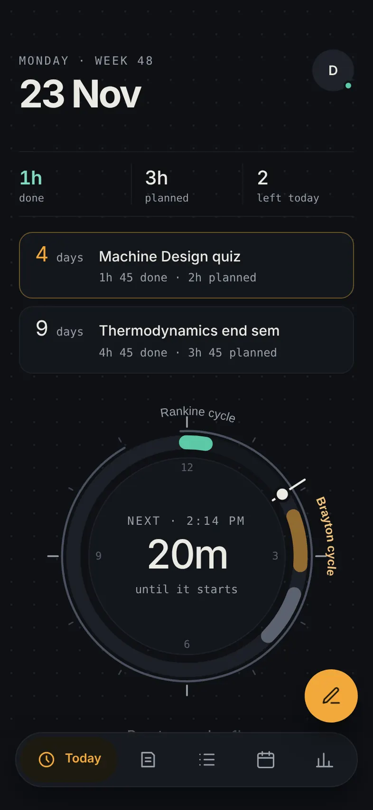
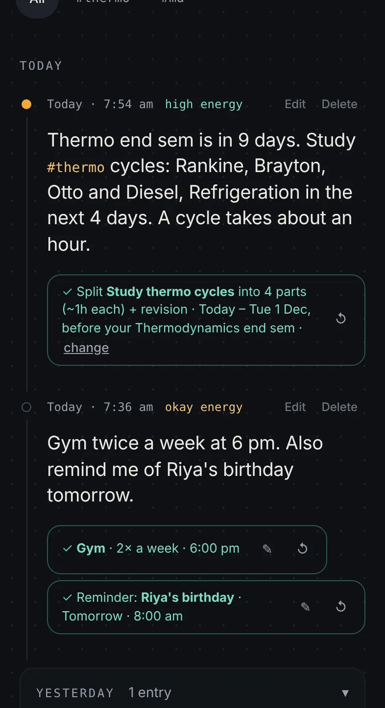
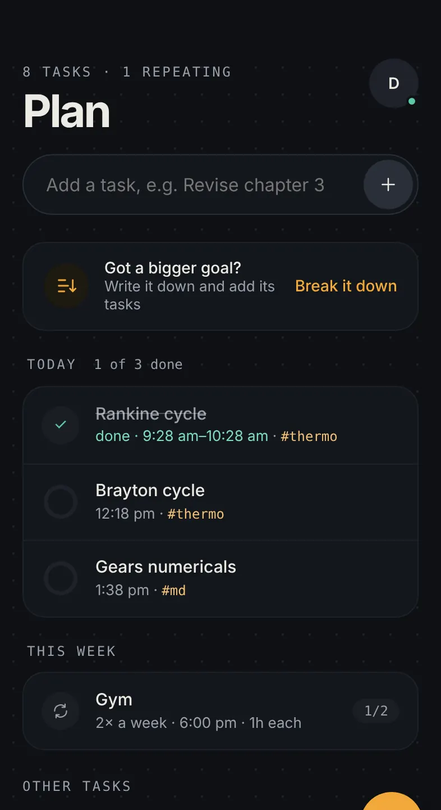
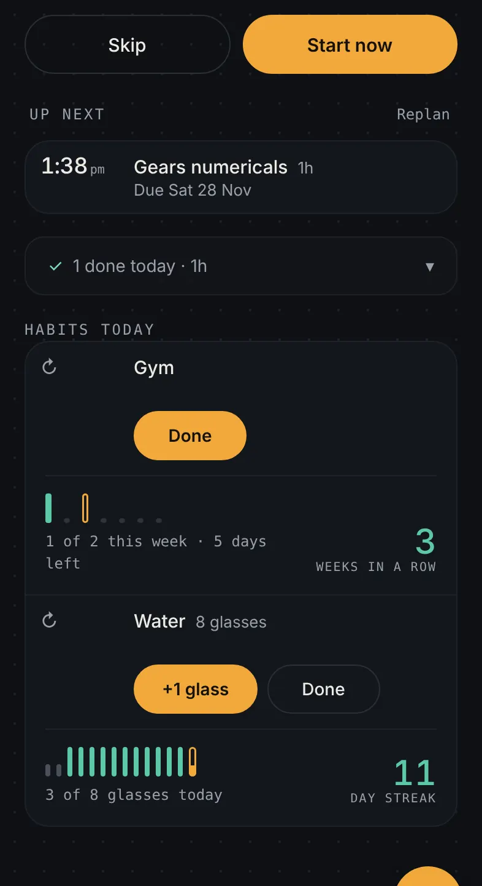

# Planner

**A journal that plans your week.** You write what you did and what you want to do. Planner turns it into sessions on your calendar, splits big plans into small ones and suggests when to do each one.

**Live:** https://planner.balajiharshw12.workers.dev · **Try the demo** on that page. It needs no sign-up and runs in your browser with a week of sample data.

<p>
  
  
  
  
</p>

I built this for myself. I am a mechanical engineering student, and I wanted one place to write about my day that also keeps my study plan up to date. I use it every day on my Android phone and my Windows laptop.

## What it does

- **Journal to calendar.** "Gym twice a week at 6 pm" or "thermo revision tomorrow at 10" goes straight onto the calendar. "I finished the lab report" ticks the task off. Vague plans ask first.
- **Splits big plans.** "Study 4 cycles in the next 4 days, about an hour each" becomes one session per cycle, in order, cut to my session length with breaks. If it is linked to an exam, a revision session goes on the evening before.
- **Suggests times.** Every task gets a time inside my working hours, around college and days off.
- **Changes plans from later entries.** "Add a 5th module and finish the first 4 before Tuesday" moves the sessions and adds the new one.
- **The rest:** habits with streaks, exam countdowns, reminders like birthdays, a Google Calendar feed, notifications before each session, a private journal that is encrypted on the device, and voice entries.

## How it works

**Reading the journal.** Each entry goes to the Gemini API with a short list of my open plans. It comes back as plans, finished work, notes about me, or changes to an existing plan. The app checks the AI's reading against the text itself. A day ("tommorow"), a time ("at 4:15"), a length ("1-2 hrs" means 90 minutes) or a repeat ("twice a week") that I wrote wins over the AI's guess.

**Placing sessions.** The scheduler (`public/planner-core.js`) works with free time slots for each day. It removes busy times and existing sessions, keeps a break between sessions and stays under a daily limit. Hard tasks go to my focus hours.

**Suggested times.** Each free slot gets two scores. One comes from my history (when I actually finished past sessions, by subject). The other is how close the slot is to the time the AI picked. With no history the AI gets 60% of the weight. That drops to 30% after about 30 finished sessions, as my own pattern takes over.

**Sync.** It works offline first. Every change is saved on the device and sent to the server when there is internet. Each row carries an update time. The newest change wins, and a delete always wins. Every 20 seconds the app asks one small question ("which tables changed?") and only downloads those.

## Tech

- **Frontend:** plain JavaScript, HTML and CSS. No framework. Installable as a PWA with a service worker for offline use.
- **Backend:** Cloudflare Workers, with D1 (SQLite) for data and a cron job for push notifications (Web Push with VAPID).
- **AI:** Gemini API, called from the server. Each user adds their own key in Settings.
- **Tests:** about 150 automated checks (scheduler, sync API, journal reading, notifications, calendar feed, habit streaks), plus browser tests with Playwright on phone and desktop sizes.

```
public/   the app: screens, scheduler (planner-core.js), service worker
src/      the Worker: API, sync, AI calls, notifications, calendar feed
migrations/  database schema
test/     automated checks
```

## Run it yourself

You need Node 20+ and a free Cloudflare account.

```bash
npm install
npm run db:local          # create the local database
npm run dev:local         # http://localhost:8787
```

Make a `.dev.vars` file first:

```
INVITE_CODE=any-word
KEY_SECRET=long-random-text
LOCAL_TESTING=1
```

Run the tests with `npm test` while the dev server is running.

To deploy your own copy, copy `wrangler.test.toml` to `wrangler.toml`, create a D1 database with `npx wrangler d1 create planner-db` and put its id in the file. Then set the secrets with `npx wrangler secret put INVITE_CODE` and `KEY_SECRET`, run `npm run db:remote`, and finish with `npm run deploy`. For notifications, run `npm run vapid` and follow what it prints.

## How it was built

I built Planner with Claude as a coding assistant. I decided what it should do and how the planning rules work, wrote the requirements for each update, and tested every version on my own phone and laptop before shipping it.
